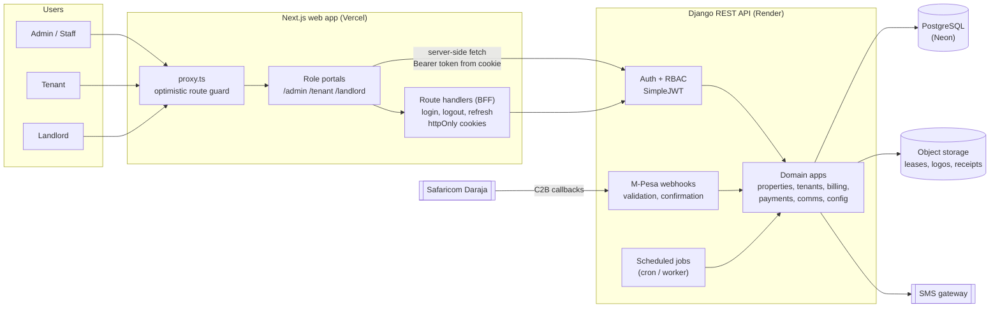
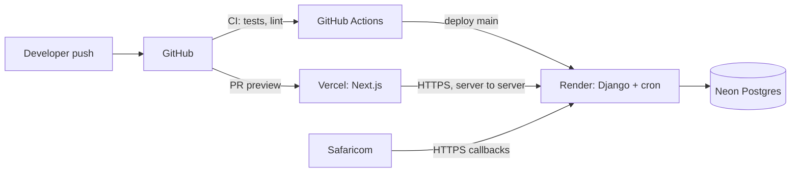
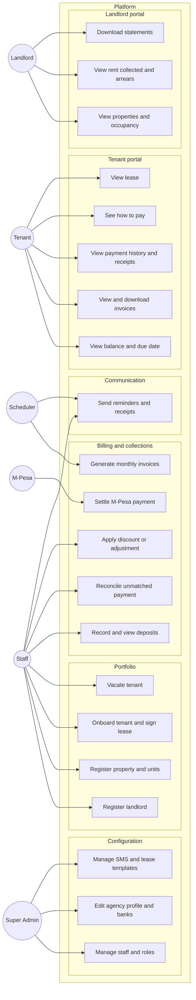
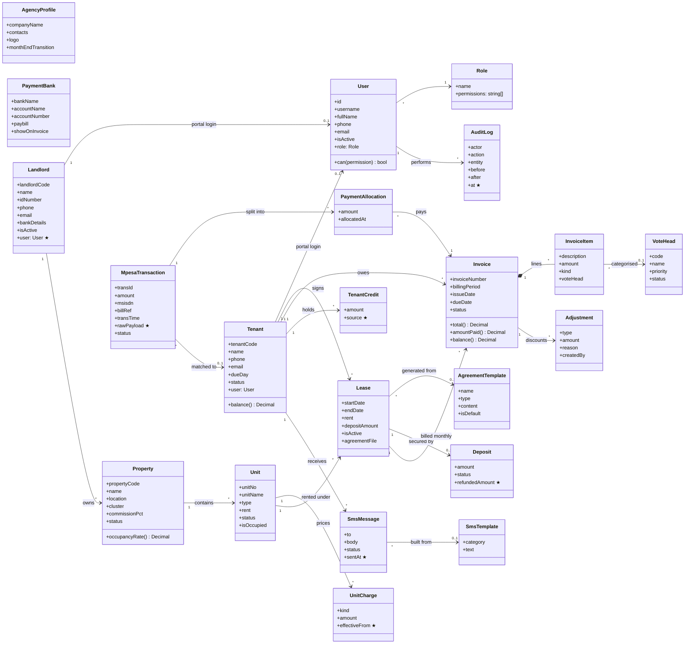
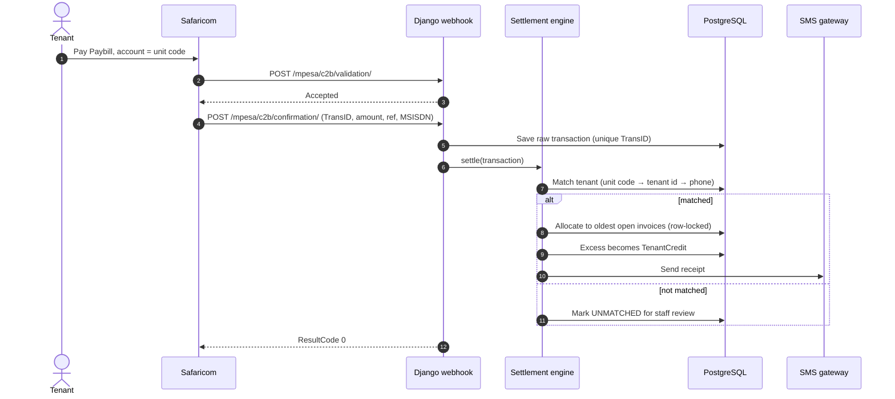
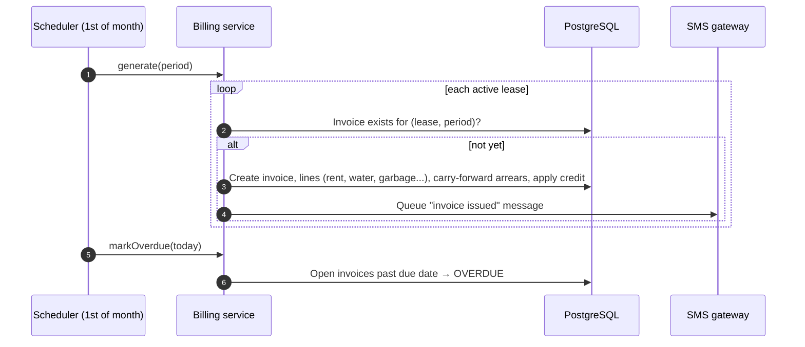
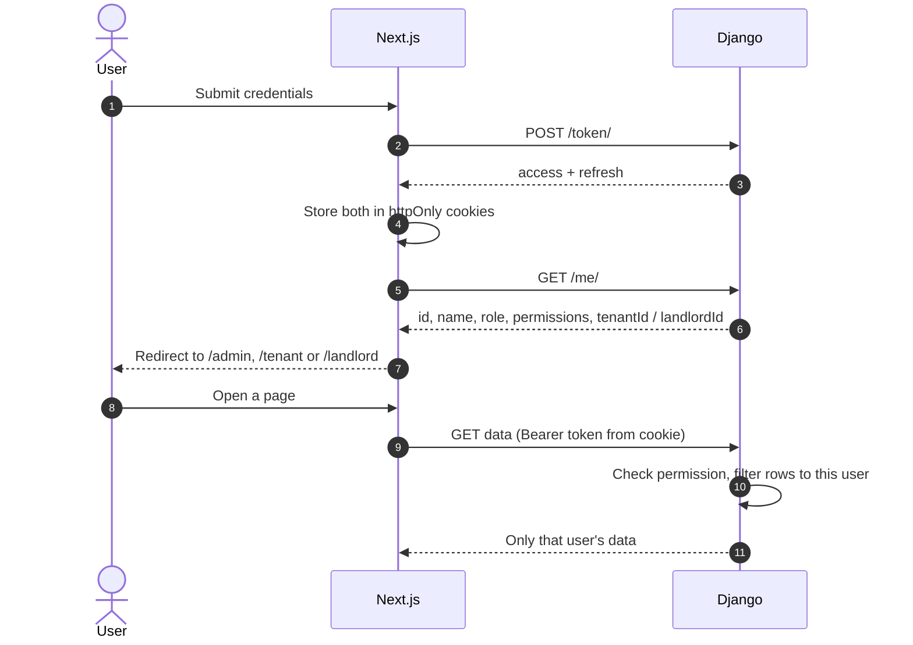
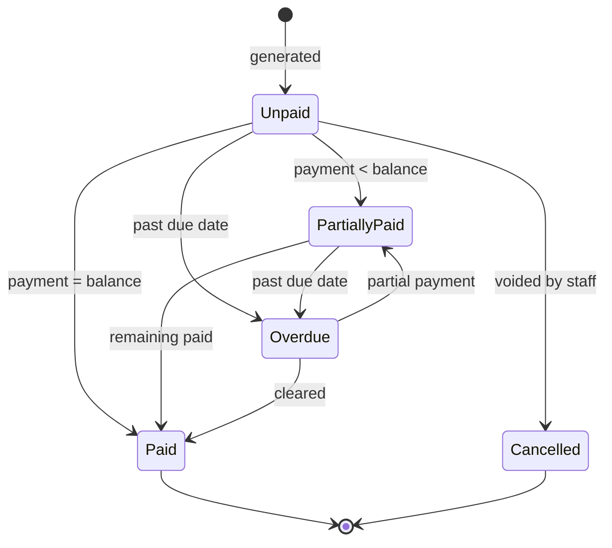
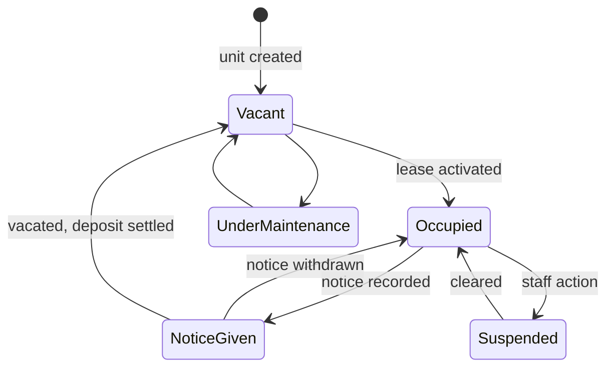

# GeoPima: System Design

A multi-role property management platform for a Kenyan property agency. Agency staff manage landlords, properties, tenants, billing and M-Pesa collections. Tenants see what they owe and what they've paid. Landlords see how their properties perform.

Contents: [1 Actors & goals](#1-actors--goals) · [2 Architecture](#2-architecture) · [3 Use cases](#3-use-cases) · [4 Domain model](#4-domain-model-class-diagram) · [5 Key flows](#5-key-flows) · [6 State machines](#6-state-machines) · [7 Access control](#7-access-control) · [8 Gap analysis vs current backend](#8-gap-analysis-vs-current-backend) · [9 Non-functional requirements](#9-non-functional-requirements)

---

## 1. Actors & goals

| Actor | Goal |
|---|---|
| **Super Admin** | Configure the agency, manage staff accounts, roles and permissions |
| **Agency staff** (Admin, Accountant, Secretary) | Run day-to-day operations: onboard landlords and tenants, bill, reconcile payments, communicate |
| **Tenant** | See balance and due dates, pay rent, get receipts, view the lease |
| **Landlord** | See properties, occupancy, rent collected and statements after commission |
| **Safaricom (M-Pesa Daraja)** *(external)* | Notifies the system of customer payments (C2B) |
| **SMS gateway** *(external)* | Delivers reminders and receipts |
| **Scheduler** *(system)* | Generates monthly invoices, flags overdue invoices, sends reminders |

---

## 2. Architecture

### 2.1 Container view



**Key decisions**

| Decision | Rationale |
|---|---|
| Next.js talks to Django **server-side**; the browser never holds a JWT | Removes the XSS token-theft risk of `localStorage`; one place for refresh logic |
| Django stays the **only** system of record and enforcer of permissions | The front end only hides UI; the API decides |
| One Next.js app, three role **route groups** | Shared design system and API client, simple deployment |
| Webhooks and jobs live in Django | They are domain logic and must work without the UI |

### 2.2 Front-end structure (Next.js)

```
src/app/
  (auth)/login
  (admin)/admin/...      landlords, properties, units, tenants, invoices, mpesa, deposits, finance, configuration
  (tenant)/tenant/...    home, invoices, payments, lease, profile
  (landlord)/landlord/...home, properties, statements, profile
  api/auth/{login,logout,refresh}
src/lib/                 api client, session, role guard, types, format
src/components/ui        shadcn/ui primitives
src/components/<domain>  tables, forms, cards shared by portals
```

### 2.3 Back-end structure (Django apps)

| App | Responsibility |
|---|---|
| `accounts` | `User`, `Role`, permissions, `/me`, audit log |
| `properties` | `Landlord`, `Property`, `Unit` |
| `tenancy` | `Tenant`, `Lease`, move-in/move-out |
| `billing` | `VoteHead`, `Invoice`, `InvoiceItem`, `Deposit`, `TenantCredit`, invoice generation |
| `payments` | `MpesaTransaction`, `Payment`, `PaymentAllocation`, settlement engine, webhooks |
| `comms` | `SmsTemplate`, `SmsMessage`, notifications |
| `agency` | `AgencyProfile`, `PaymentBank`, `AgreementTemplate` |

### 2.4 Deployment



---

## 3. Use cases

### 3.1 Use-case diagram



### 3.2 Use-case catalogue

| ID | Use case | Actor | Main flow | Alternate / exception |
|---|---|---|---|---|
| UC-01 | Sign in | All | Enter credentials, receive session, land on role portal | Wrong password (error); locked after repeated failures |
| UC-02 | Manage staff and roles | Super Admin | Create user, assign role, set permissions | Cannot remove last Super Admin |
| UC-03 | Register landlord | Staff | Enter details and bank account, optional portal login | Duplicate ID number or phone |
| UC-04 | Register property and units | Staff | Pick landlord, set commission, add units with rent and fees | Rent change creates a dated history entry |
| UC-05 | Onboard tenant | Staff | Create tenant, assign unit, generate lease from template, record deposit | Unit already occupied (blocked) |
| UC-06 | Generate monthly invoices | Scheduler / Staff | For each active lease, build invoice from unit fees and arrears | Already invoiced for the period (skipped, idempotent) |
| UC-07 | Settle M-Pesa payment | M-Pesa | Receive callback, store raw transaction, match tenant, allocate to oldest open invoices | Duplicate callback (ignored); no match → unmatched queue; overpayment → tenant credit |
| UC-08 | Reconcile unmatched payment | Staff | Open unmatched queue, pick tenant, allocate | Payment belongs to no one (mark as suspense) |
| UC-09 | Apply discount / adjustment | Staff | Add credit line to invoice with reason | Requires finance permission; audited |
| UC-10 | Vacate tenant | Staff | Record exit date, final invoice, deposit refund or deductions, free the unit | Outstanding balance deducted from deposit |
| UC-11 | Send reminders | Scheduler | Before and after due date, send SMS from template | Delivery failure is logged and retried |
| UC-12 | View balance and due date | Tenant | Open home, see amount due, due date, status | No open invoice shows "all paid" |
| UC-13 | View invoices and receipts | Tenant | List and open invoice, download PDF | Only own data (403 otherwise) |
| UC-14 | See how to pay | Tenant | Show Paybill, account reference (unit code), amount due | Future: STK push |
| UC-15 | View properties and occupancy | Landlord | List own properties with occupancy and vacancy | Only own properties |
| UC-16 | View collections and statements | Landlord | Per property: billed, collected, arrears, commission, net payable | Statement locked after month close |

---

## 4. Domain model (class diagram)

Target model. `★` marks things that do not exist yet in the current backend.



**Invariants the code must enforce**

1. A unit has at most one **active** lease. A tenant may have several leases over time.
2. `Invoice.balance = total − Σ allocations − Σ adjustments`, always computed from rows, never stored by hand.
3. `(lease, billingPeriod)` is unique, so invoice generation is idempotent.
4. `Σ allocations of a transaction ≤ transaction.amount`. Any remainder becomes `TenantCredit`.
5. Money uses `Decimal`; money rows are never deleted, only reversed by a new row (audit trail).
6. A portal user can only reach rows reachable from their own `Tenant` or `Landlord` record.

---

## 5. Key flows

### 5.1 Tenant pays by M-Pesa (C2B)



### 5.2 Monthly billing



### 5.3 Role-based sign-in and data access



---

## 6. State machines

**Invoice**



**Tenancy (lease + unit)**



**M-Pesa transaction:** `received → matched → settled`, or `received → unmatched → (staff reconciles) → settled`, or `→ suspense`.

---

## 7. Access control

| Capability | Super Admin | Admin | Accountant | Secretary | Tenant | Landlord |
|---|:-:|:-:|:-:|:-:|:-:|:-:|
| Staff, roles, agency config | ✅ | ✅ | | | | |
| Landlords, properties, units | ✅ | ✅ | view | ✅ | | own (view) |
| Tenants and leases | ✅ | ✅ | view | ✅ | own (view) | |
| Invoices | ✅ | ✅ | ✅ | view | own (view) | own properties (view) |
| Payments and reconciliation | ✅ | ✅ | ✅ | | own (view) | totals only |
| Discounts / adjustments | ✅ | ✅ | ✅ | | | |
| SMS / lease templates | ✅ | ✅ | ✅ | ✅ | | |
| Statements | ✅ | ✅ | ✅ | | | own |

Rules: permissions are checked in Django for every request; **object-level scoping** (tenant → own rows, landlord → own properties) is applied in `get_queryset`, not in the UI. The front end uses the permission list from `/me` only to hide navigation.

---

## 8. Gap analysis vs current backend

| Area | Today | Target |
|---|---|---|
| Roles | Two mechanisms (`User.roles` M2M and `UserProfile.role`); permission classes read a field that doesn't exist | One `Role` FK on `User`; `/me` endpoint |
| Landlord login | No link between `Landlord` and `User` | `Landlord.user` (optional OneToOne) |
| Payments | Two duplicate models (`properties` and `mpesa`) | One `MpesaTransaction` + `PaymentAllocation` |
| Invoice | Totals computed from the wrong relation; invoice generator references fields that don't exist | Single `Invoice` with lines, adjustments, allocations; idempotent generator |
| Unit fees | Fixed columns (`water_rate`, `garbage_fee`, …) | `UnitCharge` rows with effective dates (history) |
| Credits | Overpayments lost | `TenantCredit` |
| Audit | None | `AuditLog` on money and permission changes |
| Webhook security | None | Source allowlist or secret path, raw payload stored |
| Messaging | Templates only | `SmsMessage` log with status and retry |
| Endpoints | `AllowAny` on money endpoints | Authenticated + role + object scope everywhere |

---

## 9. Non-functional requirements

- **Security:** httpOnly cookies, HTTPS only, CORS limited to the web origin, secrets from environment, rate-limited login and webhooks.
- **Reliability:** webhook handler is idempotent and fast; settlement runs in a DB transaction with row locks; scheduler jobs are idempotent and safe to re-run.
- **Auditability:** every money or permission change records who, what, when, before and after.
- **Performance:** paginated lists, indexed lookups on tenant code, unit, phone, `TransID`, `(lease, period)`; no per-row queries in list serializers.
- **Accessibility and usability:** keyboard-navigable, readable base font, responsive from phone width (tenants will mostly use phones).
- **Testing:** unit tests for settlement and billing with Safaricom sample payloads; permission tests per role; Playwright smoke tests per portal.
- **Operations:** health endpoint, structured logs, error tracking, daily database backups.
